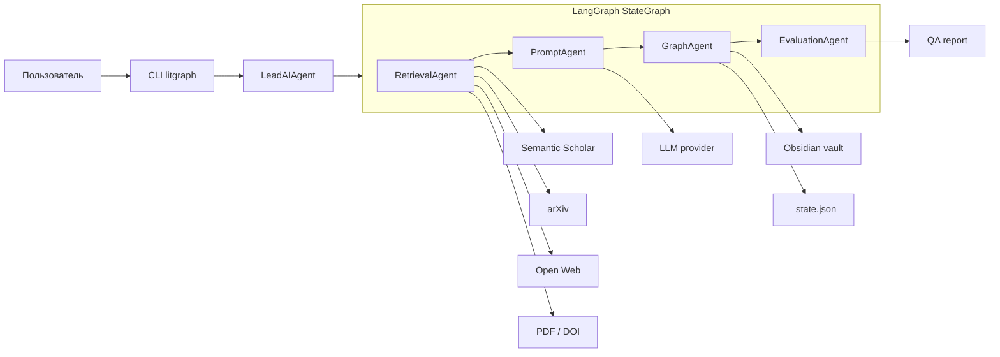
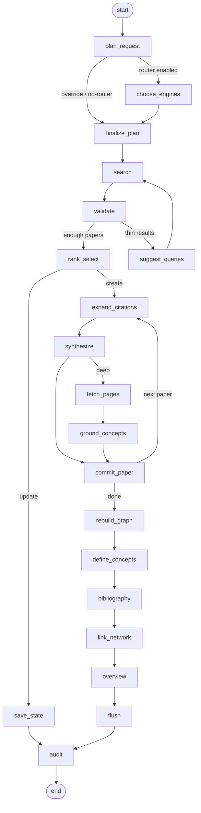
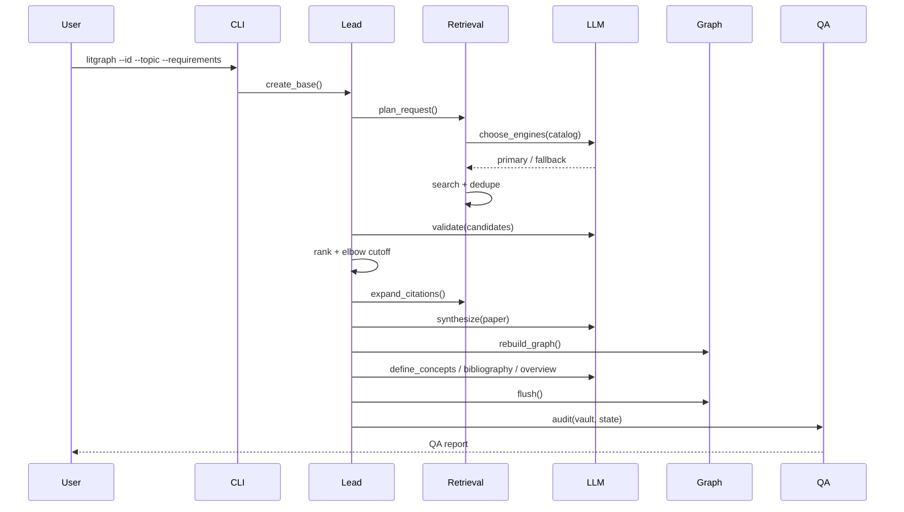
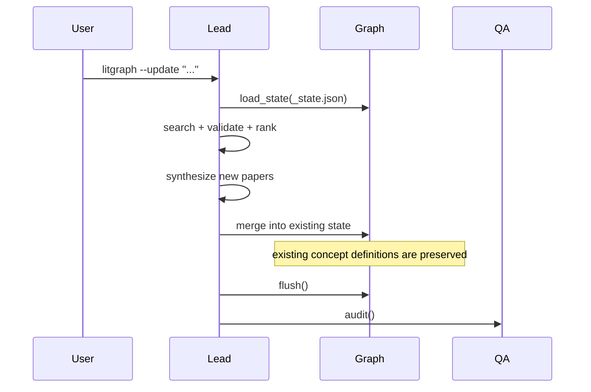

# Архитектура LitGraphAgent

Документ описывает устройство системы, потоки данных и точки расширения.
Диаграмма для презентации: [docs/kp2/assets/architecture.png](kp2/assets/architecture.png).

Подробные срезы:

- [RETRIEVAL.md](RETRIEVAL.md) — выбор движков, сбор кандидатов, ранжирование;
- [GRAPH_MODEL.md](GRAPH_MODEL.md) — онтология vault и каноникализация;
- [LLM_LAYER.md](LLM_LAYER.md) — промпты, валидация, синтез и fallback-и.

## 1. Цель и границы системы

LitGraphAgent превращает исследовательскую директиву (тема, требования, формат
цитирования, квоту) в локальный Obsidian-vault:

- атомарные заметки источников с метаданными и выжимками;
- concept hubs с каноническими определениями;
- двусторонние `[[wikilinks]]` и типизированные рёбра цитирования;
- готовую библиографию (`Formatted_Bibliography.md`, `_Bibliography.md`,
  `references.bib`);
- обзорный синтез и журнал работы агентов.

Система не является поисковой машиной общего назначения и не заменяет
экспертную проверку источников. Она автоматизирует рутину сбора, отбора,
структурирования и оформления литературы.

## 2. Компоненты

### Роли агентов

| Агент | Модуль | Ответственность |
| --- | --- | --- |
| `LeadAIAgent` | `agent/core.py` | Жизненный цикл базы, запуск workflow, CLI-интеграция |
| `RetrievalAgent` | `agent/retrieval_agent.py`, `search/` | Поиск, дедупликация, citation expansion, PDF |
| `PromptAgent` | `agent/prompt_agent.py`, `agent/synthesizer.py`, `llm/` | Валидация, синтез, концепты, библиография |
| `GraphAgent` | `agent/graph_agent.py`, `agent/concepts.py`, `storage/` | Онтология, каноникализация, запись vault |
| `EvaluationAgent` | `agent/evaluation_agent.py`, `qa/` | Аудит vault и state |

## 3. LangGraph workflow

`LiteratureWorkflow` (`agent/workflow.py`) собирает `StateGraph(ResearchState)`
для режимов `create` и `update`. Каждый шаг регистрируется как узел через
`_step(recipient, action, fn)`: обёртка вызывает метод ролевого агента,
добавляет событие в `activity` и возвращает только изменённые ключи состояния.

`ResearchState` (`agent/graph_state.py`) JSON-сериализуем: база хранится как
dict и восстанавливается в `LiteratureBaseState` внутри узлов. Runtime-объекты
(LLM-клиент, vault, агенты) живут на объекте workflow, а не в состоянии графа.

## 4. Поток создания базы

## 5. Поток обновления

## 6. Данные и персистентность

`_state.json` — durable-хранилище между запусками:

| Поле | Назначение |
| --- | --- |
| `id`, `topic`, `requirements`, `citation_format` | Директива и настройки базы |
| `papers` | Источники, метаданные, выжимки, `source_engine` |
| `concepts` | Канонические концепты и определения |
| `edges` | Рёбра графа (paper → concept, citation) |
| `search_plan` | Выбор движков, обоснование, источник решения |
| `activity` | Журнал hand-off и длительностей |

Запись атомарная: временный файл и замена, чтобы прерванный запуск не оставил
битый `_state.json`. `MemorySaver` в LangGraph хранит состояние конкретного
запуска и не заменяет durable-хранилище.

## 7. Поиск и выбор движков

Каталог движков (`search/tools.py`) содержит ключ, название, описание,
сильные и слабые стороны, лучшие сценарии. `SearchRouter` (`search/router.py`)
валидирует ответ LLM, нормализует ключи, ограничивает число primary-движков и
подбирает fallback. Решение можно обойти флагами `--engines` и `--no-router`.

Порядок:

1. `plan_request` решает, нужен ли LLM-вызов.
2. `choose_engines` просит модель выбрать primary/fallback.
3. `finalize_plan` валидирует и сохраняет план.
4. `search` выполняет primary, затем fallback, если результатов мало.
5. `source_engine` попадает в frontmatter каждой заметки.

## 8. Граф и каноникализация

`GraphAgent` строит онтологию:

- концепты канонизируются по плюралам, регистру, акронимам и скобкам;
- редко встречающиеся концепты отсекаются `MIN_CONCEPT_PAPERS`;
- имя заметки стабильно и безопасно для файловой системы;
- `graph.json` сливается с пользовательскими настройками, а не перезаписывает
  их;
- внешние ссылки получают stubs, поэтому `[[wikilinks]]` не повисают.

## 9. Контроль качества

`EvaluationAgent` не меняет состояние, только сообщает:

- unresolved links и orphan notes;
- обязательный frontmatter по типам заметок;
- дубли имён и рёбер;
- целостность concept ↔ paper ↔ hub;
- пустые библиографии и обзоры;
- покрытие канонических концептов.

Отчёт имеет severity (`error` / `warning`) и коды, поэтому `litgraph --check`
можно использовать в CI и демонстрации.

## 10. Точки расширения

Новый агент добавляется за пять шагов:

1. `TeamRole` в `agent/roles.py`;
2. сервис-класс с обычными методами;
3. инстанцирование в `agent/core.py`;
4. узел и рёбра в `agent/workflow.py`;
5. запись в `CONTRIBUTORS.md`, `docs/AGENT_TEAM.md`, `README.md`,
   `.github/CODEOWNERS` и тест.

Инварианты:

- специалист не пишет данные другого специалиста напрямую;
- все промпты — в `llm/prompts.py`;
- все записи vault — через `GraphAgent`;
- QA не мутирует состояние;
- узел возвращает только объявленные ключи `ResearchState`;
- каждый запуск заканчивается сохранённым `_state.json`.

## 11. Ограничения

- Качество зависит от LLM и внешних API; локальные модели 3–4B ограничены.
- Нет типизированного извлечения отношений уровня SciERC.
- Ранжирование эвристическое и пока не откалибровано на размеченном наборе.
- Deep mode требует доступных open-access PDF.
- CI не делает реальных сетевых вызовов: E2E проверяется локально.
