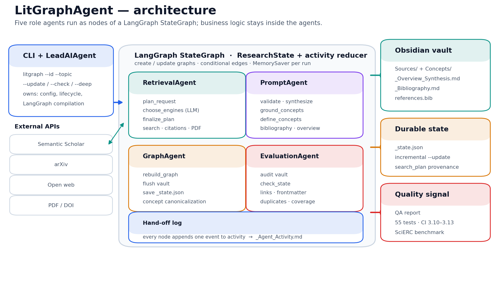

# 3. Архитектура проекта

## 3.1. Общая картина

LitGraphAgent построен как команда из пяти ролей, которые работают в одном
пайплайне. Пользователь запускает CLI, Lead-агент собирает LangGraph-workflow и
передаёт работу специалистам. Каждый шаг — отдельный узел графа; каждый
переход — ребро; каждый вызов агента оставляет событие в журнале `activity`.
В конце vault записывается на диск, а QA-агент проверяет, что ссылки, заметки
и состояние не противоречат друг другу.



Пять ролей — это не декоративная схема, а способ разделить ответственность.
Lead отвечает за жизненный цикл базы и оркестрацию. Retrieval отвечает за
поиск, дедупликацию, цитирования и PDF. Prompt отвечает за всё, что связано с
LLM: валидацию, синтез, концепты, библиографию и обзор. Graph отвечает за
онтологию, каноникализацию и запись Obsidian. QA отвечает за независимую
проверку результата. Если менять один слой, остальные остаются на месте:
например, можно заменить arXiv-клиент, не трогая промпты, или добавить
проверку QA, не меняя граф.

| Роль | Агент | Что делает |
| --- | --- | --- |
| Lead AI Engineer | `LeadAIAgent` (`LiteratureAgent`) | Жизненный цикл базы, сборка workflow, CLI, состояние |
| Data / IR Engineer | `RetrievalAgent` | Поиск, дедупликация, цитирования, PDF, кэш |
| LLM Engineer | `PromptAgent` | Валидация, синтез, концепты, библиография, обзор |
| Graph & Knowledge Engineer | `GraphAgent` | Онтология, каноникализация, запись vault, ссылки |
| QA / Evaluation Engineer | `EvaluationAgent` | Аудит vault и состояния, отчёт QA |

## 3.2. Почему именно пять ролей

Разделение возникло из реальных зон. Поиск требует знания API, ретраев,
дедупликации и ранжирования; это отдельная инженерная зона, которая быстро
меняется при добавлении нового источника. LLM-операции требуют промптов,
батчинга, JSON-устойчивости и валидации; это другая зона, где ошибки связаны
с качеством модели, а не с сетью. Граф требует онтологии, каноникализации,
имён файлов и Obsidian; это третья зона, где важны детерминизм и
совместимость с пользовательскими настройками. QA должен быть независимым:
он не пишет данные, а проверяет то, что написали другие. Lead координирует,
но не подменяет специалистов.

Такое разделение даёт три практических выигрыша. Во-первых, тесты можно
писать по слоям: retrieval тестируется отдельно от промптов, а граф — отдельно
от QA. Во-вторых, ошибку легче локализовать: если статья не прошла отбор, это
Prompt/Validator, а если ссылка не находится в Obsidian — Graph/QA. В-третьих,
новый участник может начать с одной зоны и не держать в голове весь проект
сразу.

## 3.3. LangGraph как диспетчер

`LiteratureWorkflow` (`lit_graph/agent/workflow.py`) собирает
`StateGraph(ResearchState)`. Каждый узел — это обёртка `_step(recipient,
action, fn)`, которая вызывает метод агента, замеряет время, добавляет
событие в `activity` и возвращает только изменённые ключи состояния.

Такая обёртка решает три задачи. Во-первых, она даёт единый журнал: не нужно
помнить, какой агент что сделал, — каждое событие имеет отправителя,
получателя, действие, статус, timestamp и длительность. Во-вторых, она
дисциплинирует узлы: узел не может вернуть произвольный словарь, он
возвращает только те ключи `ResearchState`, которые действительно изменил.
В-третьих, она отделяет бизнес-логику от маршрутизации: узел вызывает
`self.retrieval.search(...)`, а не реализует поиск внутри себя.

Схема режима `create` выглядит так:

```text
START
  │
  ├─ plan_request            (решаем, нужен ли LLM для выбора движков)
  ├─ choose_engines          (LLM выбирает primary/fallback)
  ├─ finalize_plan           (SearchRouter валидирует и сохраняет план)
  ├─ search                  (primary + fallback, дедупликация)
  ├─ validate                (LLM проверяет тему и требования)
  │
  ├─ если мало статей: suggest_queries → search → validate (до 3 раундов)
  │
  ├─ rank_select             (наукометрия + elbow cutoff)
  ├─ expand_citations        (references/citations для текущей статьи)
  ├─ synthesize              (summary, findings, methodology, limitations, concepts)
  │
  ├─ если --deep: fetch_pages → ground_concepts
  │
  ├─ commit_paper            (статья попадает в base)
  │
  ├─ следующая статья: снова expand_citations → ... → commit_paper
  │
  ├─ rebuild_graph           (концепты, веса, рёбра)
  ├─ define_concepts         (определения концептов батчами)
  ├─ bibliography            (форматированная библиография)
  ├─ link_network            (типизированные связи)
  ├─ overview                (обзорный синтез)
  ├─ flush                   (запись vault)
  └─ audit                   (QA)
END
```

Смысл этой схемы важнее, чем её внешний вид. Сначала система планирует поиск,
затем ищет и валидирует, затем при необходимости повторяет поиск с
подзапросами. После того как набрано достаточно статей, она ранжирует их и
выбирает голову списка. Дальше начинается ingestion: для каждой статьи
подтягиваются цитирования, делается синтез, в deep-режиме — PDF и grounding,
и только потом статья коммитится в состояние. Когда все статьи обработаны,
строится граф, определяются концепты, собирается библиография, строятся
связи, пишется обзор, vault сохраняется и проверяется QA.

Режим `update` короче. После `validate` уже известны новые статьи, поэтому
сразу идёт `expand_citations`, затем синтез и commit, а в конце — `save_state`
и `audit`. Существующие определения концептов не перезаписываются. Это
позволяет расширять базу неделями, не теряя предыдущую работу.

## 3.4. ResearchState: что передаётся между узлами

`ResearchState` (`lit_graph/agent/graph_state.py`) — это `TypedDict`, в котором
лежат только JSON-сериализуемые значения. В нём есть идентификатор запуска и
режим, тема и требования, квота и deep-флаг, вся литературная база как dict,
поисковые раунды, кандидаты, выбранные статьи, текущая статья и страницы PDF,
результаты графа, QA-отчёт и журнал активности.

Ключевая деталь: runtime-объекты (LLM-клиент, vault, агенты) не лежат в
состоянии. Они живут на объекте workflow. Это важно, потому что состояние
должно быть сериализуемым: иначе checkpoint LangGraph и `_state.json`
сломаются. Если бы в state лежал открытый клиент LLM или файловый дескриптор,
его нельзя было бы сохранить и восстановить.

Поле `activity` использует `Annotated[..., merge_activity]`. Это reducer,
который склеивает списки событий от разных узлов. Каждый узел добавляет одно
событие, а LangGraph накапливает их. Именно этот журнал потом превращается в
`_Agent_Activity.md`: пользователь видит, какой агент что сделал, в каком
порядке и сколько времени это заняло.

## 3.5. MemorySaver и `_state.json`

В проекте два уровня состояния, и их легко перепутать. `MemorySaver` — это
checkpoint LangGraph на время одного запуска. Он хранит промежуточные
значения графа и позволяет переживать шаги. `_state.json` — это
durable-хранилище между запусками. Оно лежит в vault и содержит
`LiteratureBaseState`: статьи, концепты, рёбра, библиографию, `search_plan` и
`activity`.

`MemorySaver` не заменяет `_state.json`. Если процесс упал, `_state.json`
останется; если запуск завершён, именно он позволяет `--update` продолжить
базу. Можно думать об этом так: `MemorySaver` — оперативная память запуска, а
`_state.json` — долговременная память проекта.

Запись `_state.json` атомарная. Сначала пишется `.json.tmp`, затем файл
заменяется. Это защищает от ситуации, когда прерванный запуск оставил битый
JSON. Если замена не удалась, временный файл удаляется, а старый остаётся
целым. Это маленькая деталь, но именно она отличает «игрушечный скрипт» от
инструмента, которым можно пользоваться повторно.

## 3.6. Инварианты архитектуры

При доработке проекта важно соблюдать несколько правил. Специалист не пишет
данные другого специалиста напрямую: только через свой агент. Все промпты
живут в `llm/prompts.py`; если промпт продублирован inline, изменения в одном
месте не влияют на другое, и бенчмарк начинает врать. Все записи vault идут
через `GraphAgent` и `ObsidianVaultManager`: это единственный способ
гарантировать имена файлов, YAML и ссылки. QA не мутирует состояние, только
читает и сообщает. Узел возвращает только те ключи `ResearchState`, которые он
действительно изменил. Каждый запуск заканчивается сохранённым
`_state.json`. Новый агент добавляется ролью, сервисом, узлом и тестом, а не
правкой «на месте» в середине pipeline.

Эти инварианты не бюрократия. Они снижают вероятность того, что через месяц
кто-то добавит новый шаг, который пишет в vault напрямую, и сломает
каноникализацию или QA. Архитектура держится на договорённостях, и эти
договорённости записаны в коде и документации.

## 3.7. Что происходит при ошибке

Ошибка одного узла логируется и пробрасывается: workflow не должен молча
продолжать с битым состоянием. Ошибка одного абстракта в бенчмарке не роняет
весь прогон: она попадает в `failures`, а бенчмарк идёт дальше. Ошибка сети в
retrieval не роняет запуск: клиент делает retry/backoff, а кандидат может быть
пропущен. Ошибка JSON в LLM-ответе пытается восстановиться санитайзером,
затем retry, затем fallback. QA-ошибки не отменяют запись vault, но попадают
в отчёт и CLI.

Именно эта комбинация «жёсткие инварианты + мягкая деградация» делает систему
пригодной для реальных запусков, где сеть и локальная модель ведут себя
неидеально. Жёсткие инварианты защищают целостность базы; мягкая деградация
не даёт одному сбою уничтожить весь результат.
