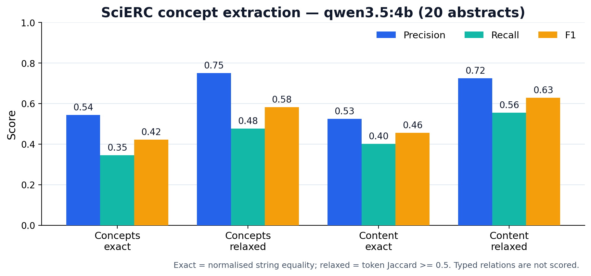

# 7. QA, тесты и бенчмарк

## 7.1. Зачем нужен отдельный QA-агент

LLM и внешние API ошибаются. Если писать vault без проверки, можно получить
битые ссылки, заметки без frontmatter, дубликаты имён, статьи, которые
ссылаются на отсутствующие концепты, пустую библиографию и «сиротские»
заметки. Эти ошибки не всегда видны на глаз, особенно когда в базе десятки
файлов. Поэтому в проекте есть независимый QA-агент.

QA не мутирует данные. Он читает vault и состояние, собирает issues с
severity и отдаёт отчёт. Это позволяет использовать `litgraph --check` в CI и
на демонстрации, а также быстро проверять базу после больших обновлений.
Независимость важна: если бы QA был частью GraphAgent, он мог бы «подгонять»
проверки под то, что только что записал, и не замечать собственные ошибки.

## 7.2. Проверки vault

`run_vault_checks(vault_path)` проходит по всем `.md` вне `.obsidian` и
`.trash`. Сначала он проверяет, что папка существует и что в ней есть
Markdown-файлы. Затем собирает имена заметок и ищет дубликаты: одинаковые
stem-имена могут привести к тому, что Obsidian не поймёт, куда ведёт ссылка.

После этого каждая заметка читается, и QA смотрит на frontmatter. Если
frontmatter нет, это warning. Если тип известен, проверяются обязательные
ключи: у `literature_note` должны быть `title` и `type`, у `concept_hub` —
`concept` и `type`, у `external_reference` — `title` и `type`, у
`synthesis_hub` — `topic` и `type`, у `master_bibliography` —
`citation_format` и `type`, у `agent_activity` — `type`. Если тип неизвестен,
это тоже warning.

Ссылки проверяются через `LINK_PATTERN`. Для каждой `[[ссылки]]` QA пытается
найти файл: если ссылка содержит путь, проверяется путь; если нет — ищется
по stem-имени. Ненайденная ссылка попадает в `unresolved_link`. Отдельно
считаются входящие и исходящие ссылки, чтобы найти сирот: заметки в
`Sources/` и `Concepts/`, у которых нет ни входящих, ни исходящих ссылок.
Наконец, проверяется `_Bibliography.md`: если там стоит «No references
available», это warning.

Статистика отчёта включает число заметок, источников, концептов, внешних
ссылок, ссылок, unresolved links и orphans. Эти числа полезны не только для
отладки, но и для отчёта: они показывают, насколько база связная.

## 7.3. Проверки состояния

`run_state_checks(state)` смотрит не на файлы, а на данные. Если статей нет,
это warning. Для каждой статьи проверяется, есть ли summary, formatted
citation и концепты. Если статья ссылается на концепт, которого нет в
`state.concepts`, это error `orphan_concept_link`: в vault такая ссылка
повиснет. Для каждого концепта проверяется, есть ли определение и упоминания.
Если библиография или обзор пусты, это warning. Для рёбер проверяются
дубликаты и неизвестные концы: source должен быть известной статьёй, target —
известной статьёй или внешней ссылкой.

Severity разделяет проблемы на `error`, `warning` и `info`. `error`
критичен, обычно ломает целостность. `warning` подозрителен, но база может
работать. `info` нужен для диагностики. `EvaluationAgent.audit` объединяет
vault- и state-отчёты и логирует summary.

Ограничение QA в том, что он проверяет структуру и целостность, а не научную
истинность. Он не может понять, что статья нерелевантна, если LLM её
пропустил. Он не заменяет бенчмарк качества извлечения. Но он ловит те
ошибки, которые человек не заметит в базе из сотни заметок.

## 7.4. Тесты и CI

В проекте 55 тестов. Они покрывают pipeline и агентов, персистентность
`_state.json`, каноникализацию концептов, имена заметок, QA, батчинг,
провайдеры и JSON-санитайзер, поисковый роутер, ранжирование и бенчмарк.
Тесты запускаются командой `pytest -q`, линтер — `ruff check lit_graph tests
benchmarks`.

CI в GitHub Actions проверяет Python 3.10, 3.11, 3.12 и 3.13. `ruff` валит
сборку при ошибках, `pytest` запускается на push и pull request. CI не делает
реальных сетевых вызовов и не запускает локальную LLM: E2E проверяется
локально, а CI ловит регрессии структуры и логики.

Такое разделение важно. Если бы CI запускал реальную модель, он был бы
медленным, дорогим и нестабильным. Поэтому CI проверяет то, что можно
проверить детерминированно: импорты, модели, каноникализацию, QA, JSON-
санитайзер, роутер и скоринг. А бенчмарк и E2E — это отдельные локальные
прогоны.

## 7.5. SciERC: что это и почему он релевантен

SciERC (Luan et al., EMNLP 2018) — стандартный бенчмарк для scientific
knowledge-graph construction. В нём 500 абстрактов научных статей с
аннотациями сущностей шести типов (Task, Method, Metric, Material, Generic,
OtherScientificTerm), типизированных отношений и coreference-кластеров.

Это не «граф вообще», а именно извлечение научных сущностей и связей из
текста. Поэтому SciERC релевантен LitGraphAgent, который тоже строит граф из
научных статей. Но есть важное отличие: LitGraphAgent извлекает канонические
концепты, а SciERC размечает спаны. Наш пайплайн не предсказывает типы
отношений SciERC, поэтому мы не считаем relation F1. Это не «забыли», а
сознательное ограничение: считать метрику на данных, которых система не
производит, было бы фикцией.

## 7.6. Что именно измеряет harness

`benchmarks/scierc_benchmark.py` загружает `.txt` и `.ann`, выбирает `limit`
абстрактов с `seed`, вызывает production `PromptAgent.synthesize_paper` и
сравнивает `extracted_concepts` с gold-упоминаниями. Он считает concept
precision/recall/F1 и paper→concept edges, сохраняет JSON и JSONL checkpoint,
умеет resume после прерывания и пишет failures, не роняя весь прогон.

Harness не измеряет типизированные отношения, coreference и span boundaries.
Он также не оценивает качество итогового обзора или поиска. Это regression
sample: 20 абстрактов достаточно, чтобы ловить регрессии, но недостаточно для
статистической значимости.

## 7.7. Exact, relaxed и content-only

Exact — это нормализованное равенство строк: lowercase, singularization,
удаление пунктуации и артиклей. Relaxed — это token Jaccard ≥ 0.5. Он
допускает модификаторы и сокращения: `word sense disambiguation (WSD)
systems` и `word sense disambiguation` считаются совпадением. Content-only —
это gold-сущности без типа Generic. Это отдельный сигнал: Generic-слова
(`system`, `method`, `approach`) часто шумят, и без них метрика показывает
содержательные концепты.

Метрики считаются micro: TP/FP/FN агрегируются по всем абстрактам, затем
считаются P/R/F1. Это стандартно для extraction, но нужно явно указывать.
Micro доминируется большими статьями, macro — маленькими; в отчёте
используется micro.

## 7.8. Результаты на 20 абстрактах

Протокол: 20 абстрактов, `seed=42`, локальные модели через Ollama,
production-вызов `PromptAgent.synthesize_paper`, 0 падений.

| Модель | Сигнал | Precision | Recall | F1 |
| --- | --- | ---: | ---: | ---: |
| `qwen2.5:3b` | Concepts, exact | 0.538 | 0.254 | 0.345 |
| `qwen2.5:3b` | Concepts, relaxed | 0.723 | 0.341 | 0.464 |
| `qwen2.5:3b` | Content, relaxed | 0.706 | 0.402 | 0.512 |
| `qwen3.5:4b`, prompt v1 | Concepts, exact | 0.556 | 0.254 | 0.349 |
| `qwen3.5:4b`, prompt v1 | Concepts, relaxed | 0.800 | 0.365 | 0.501 |
| `qwen3.5:4b`, prompt v1 | Content, relaxed | 0.774 | 0.426 | 0.549 |
| `qwen3.5:4b`, prompt v2 | Concepts, exact | 0.544 | 0.345 | 0.422 |
| `qwen3.5:4b`, prompt v2 | Concepts, relaxed | 0.750 | 0.476 | 0.583 |
| `qwen3.5:4b`, prompt v2 | Content, relaxed | 0.725 | 0.555 | 0.629 |

Среднее число концептов: `qwen2.5:3b` — 5.95, `qwen3.5:4b` prompt v1 — 5.75,
`qwen3.5:4b` prompt v2 — 8.0, gold — 12.6. Время: `qwen2.5:3b` — 252.7 с,
`qwen3.5:4b` prompt v1 — 1836.9 с, `qwen3.5:4b` prompt v2 — 3571.0 с (около
179 секунд на абстракт).

## 7.9. Что дал prompt v2

Старый промпт не задавал количество концептов и показывал три примера.
Модель выдавала около 5.75 концепта, часто общих. Новый промпт просит 6–8
концептов, требует, чтобы они были явно упомянуты, покрывает
methods/tasks/metrics/materials/datasets/technical terms, запрещает generic и
дубликаты и ставит `extracted_concepts` первым в JSON.

Прирост: exact F1 +0.073, relaxed F1 +0.082, content relaxed F1 +0.080.
Цена: почти вдвое дольше, потому что модель генерирует больше концептов и
отвечает стабильно длиннее. Для исследовательской базы это приемлемый
trade-off; для интерактивного сценария — нет.

Почему prompt v2 сработал? Причин три. Во-первых, модель получила явное
количество: 6–8 вместо неопределённого «сколько получится». Во-вторых,
концепты идут первыми в JSON, поэтому модель не тратит бюджет на summary
перед ними. В-третьих, правила запрещают generic-слова и требуют явной
поддержки в абстракте, что снижает шум. Это не «магия промпта», а
структурирование задачи.

## 7.10. Опорные точки

Чтобы числа не висели в вакууме, в отчёте фиксируются опорные точки. Пустое
предсказание даёт F1 0.000 — это нижняя граница. Gold oracle даёт 1.000 — это
верхняя граница. `qwen2.5:3b` — меньшая модель на тех же 20 абстрактах.
`qwen3.5:4b` prompt v1 — предыдущая формулировка. `qwen3.5:4b` prompt v2 —
текущий результат.

| Точка | Exact F1 | Relaxed F1 | Content relaxed F1 | Смысл |
| --- | ---: | ---: | ---: | --- |
| Пустое предсказание | 0.000 | 0.000 | 0.000 | нижняя граница |
| `qwen2.5:3b` | 0.345 | 0.464 | 0.512 | меньшая модель |
| `qwen3.5:4b`, prompt v1 | 0.349 | 0.501 | 0.549 | предыдущий промпт |
| `qwen3.5:4b`, prompt v2 | 0.422 | 0.583 | 0.629 | текущий результат |
| Gold oracle | 1.000 | 1.000 | 1.000 | верхняя граница |

Внешний ориентир — SciERC SOTA (SURE, COLING 2025): entity F1 73.4,
relation F1 56.9, strict relation F1 44.3. Это span-level NER/RE, а не
извлечение канонических концептов. Прямое сравнение некорректно: у нас другая
постановка и другой матчинг. Поэтому SOTA даётся как контекст, а не как
лидерборд.

## 7.11. Ограничения бенчмарка

Ограничения нужно понимать, чтобы не переоценить результат. 20 абстрактов —
мало для статистической значимости. Один seed. Одна модель, плюс меньшая 3B
для сравнения. Оценены только концепты, не отношения. Нет end-to-end метрики
поиска (precision@k, nDCG). Нет оценки качества итогового обзора. LLM
недетерминирована; один прогон не равен среднему. Exact — нижняя граница
из-за каноникализации. SOTA SciERC — другая задача.

До КП3 имеет смысл расширить выборку до 100 абстрактов, добавить 3 seed,
2–3 модели, triple-level F1 (если появятся типы отношений), coverage,
orphan rate, unresolved link rate, precision@k/nDCG для поиска, p95 latency
и cost per run. Это не «для галочки»: каждое расширение закрывает конкретную
слепую зону текущей оценки.

## 7.12. Как читать эту таблицу

Смотрите на content relaxed F1 как на основной сигнал качества концептов.
Смотрите на exact F1 как на нижнюю границу: каноникализация мешает точному
совпадению. Сравнивайте только строки с одинаковым протоколом (модель, seed,
prompt). Не сравнивайте наш concept F1 с SciERC entity/relation F1 напрямую.
Помните, что 20 абстрактов — regression sample, а не лидерборд. Если вы
забудете эти правила, таблица начнёт «врать» сама по себе.
