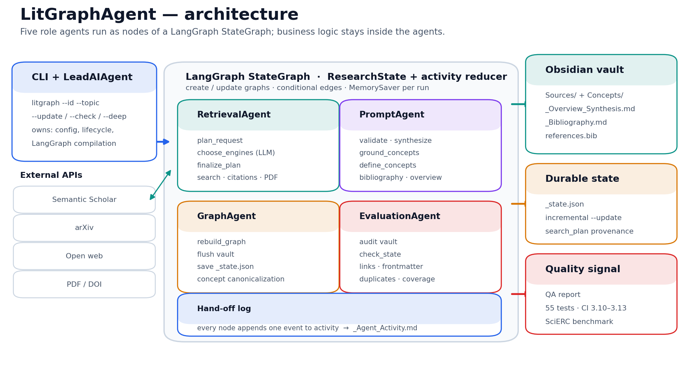
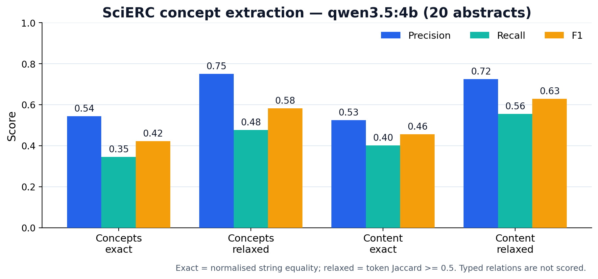

# КП2 — промежуточный отчёт LitGraphAgent

**Команда:** AI-RIldium
**Проект:** LitGraphAgent — автономный агент для сбора, наукометрической
фильтрации и построения графов литературы в Obsidian
**Репозиторий:** <https://github.com/Icold21/LitGraphAgent>
**Статус на:** 9 ноября 2026 г.
**Дата КП2:** перенесена; материалы подготовлены по исходному чек-листу КП2

---

## 1. Исходная дорожная карта и её текущий статус

Дорожная карта из КП1 (слайд «Дорожная карта реализации»):

| Дата | Этап | Плановый результат | Статус на 9 ноября |
| --- | --- | --- | --- |
| 6 октября | Базовый MVP | Поиск статей, фильтрация, генерация Obsidian-заметок | **Выполнено** |
| 5 ноября | Модульный поиск | Выбор поискового движка, первые замеры метрик | **Выполнено** |
| 25 ноября | Тестирование и стабилизация | Калибровка формулы ранжирования, инкрементальные апдейты без перезаписи | **Частично** |
| 15 декабря | Финальный релиз | Итоговый расчёт метрик, видеодемонстрация, документация | **В работе** |

Что уже подтверждено артефактами:

- MVP работает как CLI-прототип: создаёт vault, заметки источников, concept
  hubs, библиографию и синтез.
- Модульный поиск реализован: каталог движков, LLM-выбор primary/fallback,
  валидация решения и сохранение `search_plan` в `_state.json`.
- Первые метрики получены на SciERC: 20 абстрактов, 0 падений, F1 концептов
  0.422 exact / 0.583 relaxed на `qwen3.5:4b` (prompt v2).
- Инкрементальные обновления работают через `_state.json` и `--update`.
- Калибровка ранжирования пока эвристическая: формула реализована, но не
  откалибрована на размеченном наборе запросов. Это главный незакрытый пункт
  этапа 25 ноября.

## 2. Что было запланировано и что фактически реализовано

| Область | План КП1 | Факт | Комментарий |
| --- | --- | --- | --- |
| Сбор литературы | Поиск статей | arXiv, Semantic Scholar, open web; fallback-раунд; sub-queries | Реализовано шире плана |
| Фильтрация | Отбор по теме и требованиям | Один консолидированный LLM-проход по теме и требованиям | Реализовано |
| Наукометрия | Ранжирование и elbow cutoff | Citation velocity, influential-citation ratio, log-impact, Kneedle-подобный elbow | Реализовано, калибровка не завершена |
| Граф | Obsidian-заметки и связи | Atomic notes, concept hubs, `[[wikilinks]]`, typed edges, external stubs | Реализовано |
| Обновления | Инкрементальные апдейты | `_state.json`, атомарная запись, сохранение существующих определений | Реализовано |
| Архитектура | Агентный подход | Пять агентов на LangGraph `StateGraph` | Переработано по ходу проекта |
| Качество | Тесты и проверки | 55 тестов, QA-агент, CI на Python 3.10–3.13 | Реализовано |
| Метрики | Первые замеры | SciERC-бенчмарк на 20 абстрактах | Реализовано частично: только concept extraction |
| Демо | Видеодемонстрация | Сценарий описан, запись не сделана | Задача до КП3 |

Итог: ядро pipeline и инфраструктура качества готовы. Незакрытые направления —
эмпирическая калибровка ранжирования, end-to-end оценка поиска, расширение
бенчмарка и доказательства индивидуального вклада.

## 3. Что реализовано: архитектура и компоненты

### 3.1. Общая схема



Пять ролевых агентов работают как узлы LangGraph `StateGraph`:

| Агент | Роль | Зона ответственности |
| --- | --- | --- |
| `LeadAIAgent` (`LiteratureAgent`) | Lead AI Engineer | Сквозная архитектура, workflow, CLI, персистентность |
| `RetrievalAgent` | Data / IR Engineer | arXiv, Semantic Scholar, open web, PDF, кэш, citation expansion |
| `PromptAgent` | LLM Engineer | Промпты, валидация, синтез, определения концептов, библиография |
| `GraphAgent` | Graph & Knowledge Engineer | Онтология, каноникализация, `[[wikilinks]]`, запись vault |
| `EvaluationAgent` | QA / Evaluation Engineer | Аудит vault и state, проверки связности и форматов |

Бизнес-логика остаётся внутри агентов. LangGraph отвечает только за
маршрутизацию, состояние выполнения и журнал hand-off. `_state.json` остаётся
durable-хранилищем между запусками, а `MemorySaver` даёт состояние конкретного
запуска.

### 3.2. Основные компоненты

- **CLI.** `litgraph` с командами создания, обновления, проверки, удаления,
  просмотра команды и каталога движков.
- **Динамический выбор движков.** LLM читает каталог описаний и выбирает
  primary/fallback; `SearchRouter` валидирует и нормализует план. Решение
  можно переопределить флагами `--engines` и `--no-router`.
- **Поиск и дедупликация.** Агрегация запросов, дедупликация по названию,
  слияние метаданных, retry/backoff, дисковый кэш.
- **Наукометрическое ранжирование.** Citation velocity, influential-citation
  ratio, log-scaled impact и elbow cutoff.
- **Синтез.** Summary, key findings, methodology, limitations, определения
  концептов, библиография, обзорный литературный обзор.
- **Граф.** Каноникализация концептов, веса узлов, типизированные рёбра,
  concept hubs, внешние stubs без dangling links.
- **Персистентность.** `_state.json`, атомарная запись, `--update` без
  перезаписи существующих определений.
- **QA.** Проверки неразрешённых ссылок, сирот, дублей, frontmatter,
  целостности concept ↔ paper, пустых библиографий.
- **Deep mode.** Скачивание open-access PDF и привязка упоминаний концептов к
  страницам.

### 3.3. Что изменилось в архитектуре по сравнению с КП1

В КП1 архитектура описывалась как последовательность «директива → адаптивный
сбор → семантический аудит → наукометрический баланс → Obsidian vault».
Фактическая реализация сохранила эту логику, но добавила два уровня:

1. **LangGraph-оркестрация.** Вместо самописной шины сообщений workflow
   собран как `StateGraph` с явными узлами, рёбрами и conditional routing.
   Это упрощает отладку: видно, какой агент вызвал какой шаг и сколько он
   занял.
2. **LLM-driven выбор поисковых движков.** Появился каталог описаний
   (`search/tools.py`) и узел `choose_engines`. Это развитие пункта
   «модульный поиск»: выбирается не только модуль, но и стратегия под задачу.

Оба изменения не меняют итоговую цель проекта: на входе тема и требования, на
выходе — связный Obsidian-vault с источниками, концептами и библиографией. Они
улучшают управляемость и объяснимость pipeline.

## 4. Работающий прототип и отдельные компоненты

Прототип запускается из корня репозитория:

```bash
python -m venv .venv
.venv\Scripts\activate          # Windows
pip install -e ".[dev]"

litgraph \
  --id "transformer_circuits" \
  --topic "Mechanistic Interpretability and Induction Heads in Transformers" \
  --requirements "Peer-reviewed or high-impact preprints published after 2021" \
  --format "APA 7th" \
  --max-papers 5
```

Проверка результата:

```bash
litgraph --list
litgraph --check --id "transformer_circuits"
```

Что можно показать как работающие компоненты:

| Компонент | Как проверить |
| --- | --- |
| CLI и создание vault | `litgraph --help`, запуск create, структура `vaults/<id>/` |
| Выбор поисковых движков | `litgraph --tools`, вывод `search_plan` в логе и `_state.json` |
| Инкрементальное обновление | `litgraph --update ...`, сравнение `_state.json` до/после |
| Граф и ссылки | открыть vault в Obsidian, graph view, отсутствие unresolved links |
| QA | `litgraph --check --id ...`, отчёт по errors/warnings |
| Тесты | `pytest -q` — 55 тестов |
| Бенчмарк | `python benchmarks/scierc_benchmark.py ...` |

Полный воспроизводимый сценарий демонстрации: [DEMO.md](DEMO.md).

## 5. Ссылка на репозиторий

- **Репозиторий:** <https://github.com/Icold21/LitGraphAgent>
- **Лицензия:** MIT
- **Основная ветка:** `main`
- **Ключевые коммиты:**
  - `b1661a8` — пересборка проекта как five-agent team;
  - `cb4546d` — LLM-driven выбор поисковых движков;
  - `d40205d` — перевод оркестрации на LangGraph;
  - `febcd31` — SciERC-бенчмарк и результаты в README.

## 6. Первые результаты по заявленным метрикам

### 6.1. SciERC: извлечение концептов

SciERC (Luan et al., EMNLP 2018) — стандартный бенчмарк для scientific
knowledge-graph construction: 500 абстрактов с сущностями Task, Method, Metric,
Material, Generic и OtherScientificTerm. Пайплайн не предсказывает типизированные
отношения SciERC, поэтому оценивались только те сигналы, которые он реально
строит:

- **concept nodes** — концепты, извлечённые из абстракта;
- **paper → concept edges** — бипартитные рёбра, из которых собирается граф.

Протокол: 20 абстрактов, `seed=42`, локальные модели через Ollama,
production-вызов `PromptAgent.synthesize_paper`, 0 падений. Прогоны выполнены
на `qwen2.5:3b` и `qwen3.5:4b`.



| Модель | Сигнал | Precision | Recall | F1 |
| --- | --- | ---: | ---: | ---: |
| `qwen2.5:3b` | Concept nodes, exact | 0.538 | 0.254 | 0.345 |
| `qwen2.5:3b` | Concept nodes, relaxed | 0.723 | 0.341 | 0.464 |
| `qwen2.5:3b` | Content entities only, relaxed | 0.706 | 0.402 | 0.512 |
| `qwen3.5:4b` | Concept nodes, exact | 0.544 | 0.345 | 0.422 |
| `qwen3.5:4b` | Concept nodes, relaxed | 0.750 | 0.476 | 0.583 |
| `qwen3.5:4b` | Content entities only, relaxed | 0.725 | 0.555 | **0.629** |

Метрики:

- **exact** — нормализованное равенство строк (lowercase, singular, без
  пунктуации);
- **relaxed** — token Jaccard ≥ 0.5, допускает модификаторы и сокращения.

Средние значения: 5.95 (`qwen2.5:3b`) и 8.0 (`qwen3.5:4b`) извлечённых
концептов на абстракт против 12.6 уникальных gold-упоминаний. Полные прогоны
заняли около 253 и 3571 секунды соответственно. Сырые результаты:
[`scierc_qwen2.5-3b.json`](../../benchmarks/results/scierc_qwen2.5-3b.json) и
[`scierc_qwen3.5-4b-prompt8.json`](../../benchmarks/results/scierc_qwen3.5-4b-prompt8.json).

Это результат prompt v2: модель просят вернуть 6–8 конкретных концептов.
Предыдущая формулировка давала 0.349 exact / 0.501 relaxed / 0.549 content
relaxed F1; прирост — +0.073 / +0.082 / +0.080 F1 соответственно. Цена —
более долгий прогон: около 179 секунд на абстракт вместо 92.

### 6.2. Почему exact ниже relaxed

Пайплайн возвращает канонические концепты, а не копирует аннотированные спаны.
Например, gold `word sense disambiguation (WSD) systems` и предсказание
`word sense disambiguation` совпадают по смыслу, но не по строке. Поэтому exact
является нижней оценкой, а relaxed — более честной для задачи каноникализации.

### 6.3. Опорные точки: с чем сравниваем

Чтобы числа не висели в вакууме, в отчёте фиксируются четыре опорные точки:

| Точка сравнения | Exact F1 | Relaxed F1 | Content relaxed F1 | Что это |
| --- | ---: | ---: | ---: | --- |
| Пустое предсказание | 0.000 | 0.000 | 0.000 | нижняя граница: концепты не извлекаются |
| `qwen2.5:3b` | 0.345 | 0.464 | 0.512 | меньшая модель, те же 20 абстрактов и seed |
| `qwen3.5:4b`, prompt v1 | 0.349 | 0.501 | 0.549 | предыдущая формулировка |
| `qwen3.5:4b`, prompt v2 | 0.422 | 0.583 | 0.629 | текущая формулировка 6–8 концептов |
| Gold oracle | 1.000 | 1.000 | 1.000 | верхняя граница: возвращаются все gold-упоминания |

Внешний ориентир — SciERC SOTA (SURE, COLING 2025): entity F1 73.4,
relation F1 56.9, strict relation F1 44.3. Эти числа относятся к span-level
NER/RE и официальному протоколу SciERC, а не к извлечению канонических
концептов. Поэтому они даны как контекст, а не как прямое сравнение.

### 6.4. Инженерные метрики

| Метрика | Значение |
| --- | --- |
| Тесты | 55 проходят |
| Покрытие тестами | не измерено (задача до КП3) |
| CI | GitHub Actions, Python 3.10, 3.11, 3.12, 3.13 |
| Линтер | `ruff check lit_graph tests benchmarks` — без ошибок |
| Падения в бенчмарке | 0 из 20 |
| Время на абстракт | около 12.6 с (`qwen2.5:3b`) и 179 с (`qwen3.5:4b` prompt v2), Ollama |

### 6.5. Ограничения текущей оценки

- 20 абстрактов и один seed — недостаточно для статистически значимого вывода.
- Оценён только concept extraction; типизированные отношения и coreference не
  оценивались.
- Нет end-to-end метрики качества поиска: precision@k и nDCG на размеченном
  наборе запросов ещё не считались.
- Две модели, но по одному прогону на модель; LLM недетерминирован.
- Бенчмарк не измеряет качество итогового литературного обзора.

Эти ограничения зафиксированы в [benchmarks/README.md](../../benchmarks/README.md)
и не маскируются в отчёте.

## 7. Изменения плана, риски и причины отклонений

| Изменение / риск | Причина | Влияние | Что делаем |
| --- | --- | --- | --- |
| Оркестрация переведена на LangGraph | Самописная шина усложняла отладку и журналирование | Плюс: явные узлы, состояние, activity log. Минус: зависимость от версии LangGraph | Версия закреплена `langgraph>=0.3,<0.4`; логика агентов не зависит от графа |
| Выбор движков отдан LLM | Фиксированный набор движков плохо подходил разным темам | Плюс: адаптивность. Минус: недетерминизм и лишний вызов | Каталог описаний, валидация `SearchRouter`, fallback, флаги `--engines` / `--no-router` |
| Бенчмарк сужен до концептов | Пайплайн не предсказывает типы отношений SciERC | Честная метрика вместо фиктивной relation F1 | В отчёте и README явно указано ограничение |
| Маленькая выборка (20 абстрактов) | Ограничение времени и локального GPU | Высокая дисперсия оценки | До КП3: 100 абстрактов, 2 модели, 3 seed |
| Локальная модель 3B | GTX 1660 Ti, 6 ГБ VRAM | Слабее recall, чем у больших моделей | Запуск 4B при свободной VRAM; вынести модель в конфиг отчёта |
| Таймауты LLM | Reasoning-модели медленные на длинных абстрактах | Падения прогона | `--timeout`, `--retries`, checkpoint/resume, запись `failures` |
| Нет end-to-end метрики поиска | Нужен размеченный набор запросов | Нельзя утверждать качество отбора статей | До КП3: 3–5 тем, ручная разметка top-k, precision@k и nDCG |
| В git-истории все коммиты с одной учётной записи | Проект разрабатывался в одном рабочем каталоге | Риск для пункта «вклад каждого участника» | CODEOWNERS и CONTRIBUTORS фиксируют зоны; до КП3 каждый участник делает коммиты/PR по своим модулям |
| Нет видеодемонстрации | Фокус на коде и метриках | Не закрыт пункт КП3 | Записать после стабилизации UI-сценария |

Отклонений, которые меняют итоговую цель, нет. Проект по-прежнему строит
локальный граф смысловых концептов в Obsidian и автоматическую библиографию.
Изменения касаются способа оркестрации и честности оценки.

## 8. Задачи до финальной защиты (15 декабря)

| Задача | Ответственный | Результат |
| --- | --- | --- |
| Расширить SciERC до 100 абстрактов, 2 модели, 3 seed | Давид, Илья | Таблица mean ± std, error analysis |
| Добавить end-to-end оценку поиска | Нодар, Давид | precision@k и nDCG на 3–5 размеченных темах |
| Калибровать формулу ранжирования | Нодар | Сравнение эвристик на кэше кандидатов, обоснованный выбор |
| Измерить покрытие тестами | Давид | `pytest --cov`, целевой порог, отчёт |
| Добавить E2E smoke-тест без сети | Давид, Иван | Тест полного workflow на mock-провайдере |
| Записать демонстрацию | Иван | 3–5 минут: create → vault → graph → update → check |
| Подготовить скриншоты vault и graph view | Вадим | 5–7 содержательных скриншотов |
| Описать архитектуру с диаграммами | Иван, Вадим | `docs/ARCHITECTURE.md` + PNG |
| Собрать доказательства вклада участников | Все | Коммиты/PR по зонам, таблица артефактов |
| Финализировать отчёт и слайды КП3 | Иван | PDF/PPTX, инструкция по запуску |

## 9. Конкретный вклад участников

| Участник | Роль | Модули и артефакты | Что показываем |
| --- | --- | --- | --- |
| Иван Холодило (@Icold21) | Lead AI Engineer | `agent/core.py`, `agent/workflow.py`, `agent/graph_state.py`, `agent/roles.py`, `cli.py`, `config.py` | LangGraph workflow, CLI, персистентность, интеграция агентов |
| Вадим Лялькин (@Geniy_molodec) | Graph & Knowledge Engineer | `agent/graph_agent.py`, `agent/concepts.py`, `storage/`, `models.py` | Онтология vault, каноникализация, wikilinks, graph preset |
| Нодар Чигладзе (@NodarNeo) | Data / IR Engineer | `agent/retrieval_agent.py`, `search/`, `utils/http.py`, `utils/cache.py` | arXiv/S2/web, дедупликация, retry/backoff, citation expansion, PDF |
| Давид Чигладзе (@David52228) | QA / Evaluation Engineer | `agent/evaluation_agent.py`, `qa/`, `tests/`, `.github/workflows/ci.yml` | QA-проверки, 55 тестов, CI-матрица, `--check` |
| Илья Синко (@mang1ch5) | LLM Engineer | `agent/prompt_agent.py`, `agent/validator.py`, `agent/synthesizer.py`, `llm/` | Промпты, консолидированная валидация, синтез, батчинг, JSON-устойчивость |

**Важное уточнение по доказательствам.** В текущей git-истории коммиты сделаны
с одной учётной записи. Зоны ответственности зафиксированы в
[`CONTRIBUTORS.md`](../../CONTRIBUTORS.md) и
[`.github/CODEOWNERS`](../../.github/CODEOWNERS), но для КП3 этого недостаточно:
нужны коммиты или PR от каждого участника по его модулям. Это осознанный риск,
а не выдаваемое за факт распределение.

## 10. Самооценка выполненной работы

**Что получилось:**

- собран работающий end-to-end прототип, а не набор разрозненных модулей;
- архитектура стала объяснимой: пять ролей, явные узлы, журнал hand-off;
- есть воспроизводимый бенчмарк с сырыми результатами, тестами и командой
  запуска;
- QA и CI встроены в процесс, а не добавлены в конце;
- ограничения оценки сформулированы честно.

**Что пока слабо:**

- метрики покрывают только извлечение концептов, а не весь pipeline;
- выборка мала, статистической значимости нет;
- ранжирование не откалибровано эмпирически;
- вклад участников пока подтверждён владением файлами, а не историей коммитов;
- нет видеодемонстрации и скриншотов vault.

**Оценка готовности к КП2:** 8/10. Основные пункты чек-листа закрыты
артефактами; глубина оценки качества и доказательства вклада требуют усиления
до КП3.

**Что считаем главным результатом КП2:** переход от «идеи и MVP» к
воспроизводимой системе с архитектурой, тестами, бенчмарком и понятным планом
до финальной защиты.

---

## Приложение: воспроизведение

```bash
# 1. Установка
pip install -e ".[dev]"

# 2. Тесты и линтер
pytest -q
ruff check lit_graph tests benchmarks

# 3. Бенчмарк
curl -L -o sciERC_raw.tar.gz \
  https://nlp.cs.washington.edu/sciIE/data/sciERC_raw.tar.gz
tar -xzf sciERC_raw.tar.gz

python benchmarks/scierc_benchmark.py \
  --data-dir ./raw_data \
  --limit 20 \
  --seed 42 \
  --model qwen3.5:4b \
  --base-url http://localhost:11434/v1 \
  --output benchmarks/results/scierc_qwen3.5-4b.json

# 4. График из сырых метрик
python benchmarks/plot_results.py benchmarks/results/scierc_qwen3.5-4b.json
```

Подробный протокол: [benchmarks/README.md](../../benchmarks/README.md).
