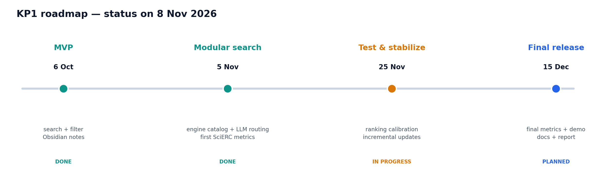
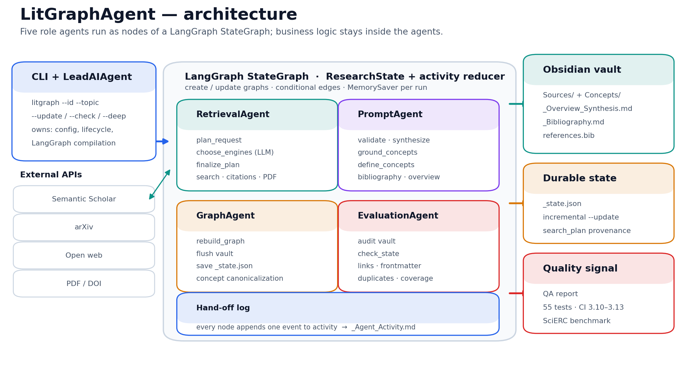
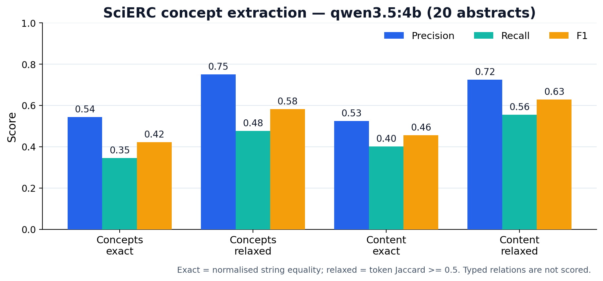

# КП2 — структура презентации и текст выступления

Регламент КП2: 2 минуты доклад + 1 минута вопросы. Ниже 7 слайдов; в PPTX
добавлены заметки докладчика с таймингом.

## Слайд 1. Титул

**LitGraphAgent**
Автономный агент для сбора, наукометрической фильтрации и построения графов
литературы в Obsidian.

- Команда AI-RIldium
- Репозиторий: github.com/Icold21/LitGraphAgent
- КП2, ноябрь 2026

## Слайд 2. Дорожная карта: план и статус

- 6 октября — MVP: поиск, фильтрация, Obsidian-заметки. **Готово.**
- 5 ноября — модульный поиск и первые метрики. **Готово.**
- 25 ноября — тесты и стабилизация. **В работе.**
- 15 декабря — финальный релиз. **По плану.**

## Слайд 3. Архитектура

- Пять ролей: Lead, Retrieval, Prompt, Graph, QA.
- LangGraph `StateGraph`: явные узлы, рёбра и журнал hand-off.
- `_state.json` — durable-состояние между запусками.

## Слайд 4. Что уже работает

- CLI: create, update, check, list, delete, `--team`, `--tools`.
- Три источника: Semantic Scholar, arXiv, open web + PDF в `--deep`.
- LLM выбирает поисковые движки из каталога, решение валидируется.
- Vault: источники, concept hubs, `[[wikilinks]]`, библиография, `references.bib`.
- Инкрементальные обновления без перезаписи существующих определений.
- QA-агент проверяет ссылки, frontmatter, дубли и целостность графа.

## Слайд 5. Качество: первые метрики

SciERC, 20 абстрактов, `qwen3.5:4b`, `seed=42`, 0 падений.

| Сигнал | P | R | F1 |
| --- | ---: | ---: | ---: |
| Концепты, exact | 0.544 | 0.345 | 0.422 |
| Концепты, relaxed | 0.750 | 0.476 | 0.583 |
| Только content, relaxed | 0.725 | 0.555 | **0.629** |

На `qwen2.5:3b`: F1 0.345 exact / 0.464 relaxed / 0.512 content relaxed.
Предыдущий промпт на 4B: 0.349 / 0.501 / 0.549.

Опорные точки: пустое предсказание — 0; oracle — 1.0.

**Аналоги SciERC** (span-level NER/RE, не наш concept F1):

| Модель | Entity F1 | Relation F1 | Strict Rel F1 |
| --- | ---: | ---: | ---: |
| SciIE, 2018 | 64.2 | 39.3 | — |
| DyGIE++, 2019 | 67.5 | 48.4 | — |
| SpERT, 2019 | 70.3 | 50.8 | — |
| PL-Marker, 2022 | 69.9 | 53.2 | 41.6 |
| SURE, 2025 | 73.4 | 56.9 | 44.3 |

Прямое сравнение некорректно: аналоги обучены на SciERC, предсказывают
границы спанов и типы отношений, а мы оцениваем канонические концепты
zero-shot LLM на 20 абстрактах с concept matching. Link prediction
(`FB15k-237` MRR ~0.42, `WN18RR` ~0.58–0.61, OGB wikikg2 0.739) — тоже
другая задача.

Плюс: 55 тестов, CI на Python 3.10–3.13, `ruff` без ошибок.

## Слайд 6. Изменения плана и риски

- Оркестрация переведена на LangGraph — проще отлаживать и объяснять.
- Выбор движков отдан LLM — адаптивность, но нужна валидация и fallback.
- Бенчмарк сужен до концептов: типизированные отношения SciERC пайплайн не
  предсказывает.
- Ограничения: 20 абстрактов на модель, один seed, нет end-to-end метрики поиска.
- До 15 декабря: 100 абстрактов, 3 seed, precision@k/nDCG, coverage,
  E2E smoke-тест, демо и скриншоты.

## Слайд 7. Команда и самооценка

| Участник | Зона |
| --- | --- |
| Иван Холодило | Архитектура, LangGraph, CLI, состояние |
| Вадим Лялькин | Онтология графа, wikilinks, Obsidian |
| Нодар Чигладзе | arXiv / S2 / web, ранжирование, PDF |
| Давид Чигладзе | QA, тесты, CI, бенчмарк |
| Илья Синко | Промпты, валидация, синтез |

**Готовность к КП2: 8/10.** Ядро и инфраструктура качества готовы; глубина
оценки и доказательства вклада — основные задачи до КП3.

---

## Текст выступления (2 минуты)

**[0:00–0:15] Слайд 1.**
LitGraphAgent превращает тему и требования в готовый Obsidian-граф
литературы: источники, концепты, связи и библиография. Репозиторий открыт,
лицензия MIT.

**[0:15–0:35] Слайд 2.**
По дорожной карте КП1 мы закрыли два этапа: MVP к 6 октября и модульный поиск
к 5 ноября. Первые метрики уже получены. Сейчас идёт этап стабилизации, а
финальный релиз — к 15 декабря.

**[0:35–0:55] Слайд 3.**
Архитектура — пять ролевых агентов на LangGraph. Lead компилирует граф,
Retrieval отвечает за источники, Prompt — за LLM-операции, Graph пишет vault,
QA проверяет результат. LangGraph не содержит бизнес-логику: он только
маршрутизирует шаги и ведёт журнал hand-off. Состояние между запусками
хранится в `_state.json`.

**[0:55–1:15] Слайд 4.**
Прототип работает целиком: CLI создаёт и обновляет базу, три поисковых
движка выбираются моделью из каталога, PDF подтягиваются в deep-режиме.
На выходе — атомарные заметки, concept hubs, двусторонние ссылки и
библиография. QA-агент проверяет связность и форматы, а `--update` не
перезаписывает существующие определения.

**[1:15–1:40] Слайд 5.**
Качество подтверждаем на SciERC — стандартном бенчмарке для scientific
knowledge graph construction. Двадцать абстрактов, две локальные модели, ноль
падений. На модели 4B F1 по концептам — 0.422 при exact-совпадении и 0.583 при
relaxed; если убрать служебные Generic-сущности, relaxed F1 достигает 0.629.
Это на 0.073–0.082 F1 выше предыдущего промпта. Плюс 55 тестов и CI на четырёх
версиях Python.

**[1:40–1:55] Слайд 6.**
Главное изменение плана — переход на LangGraph и LLM-выбор движков. Главный
риск — узкая оценка: только концепты, двадцать абстрактов на модель, один seed.
До финала расширяем выборку, добавляем end-to-end метрики поиска и покрытие
тестами.

**[1:55–2:00] Слайд 7.**
Готовность к КП2 оцениваем в 8 из 10. Ядро и инфраструктура качества готовы,
основные усилия до декабря — глубина оценки и доказательства вклада каждого.
